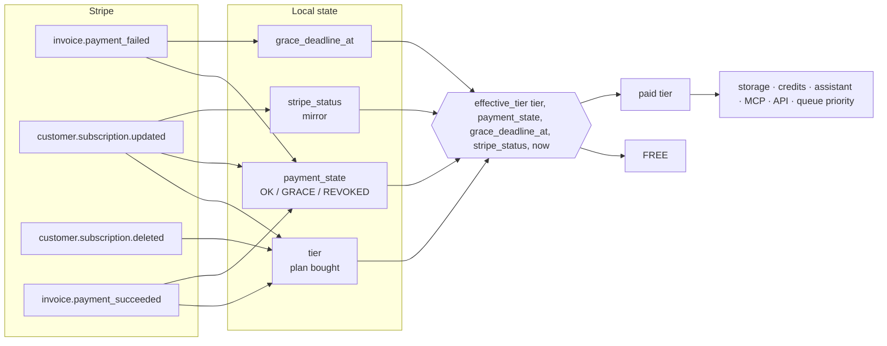
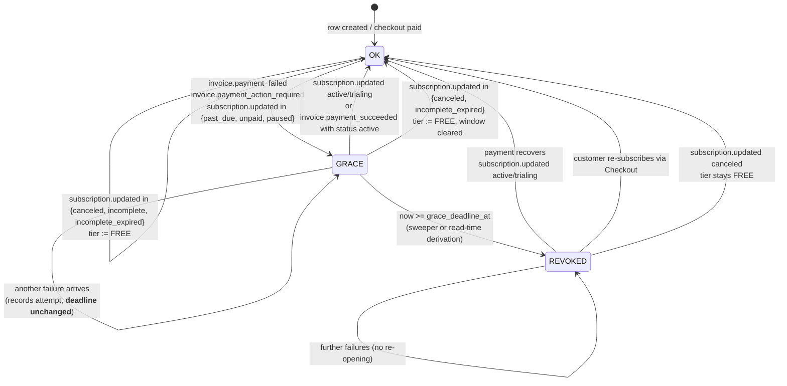
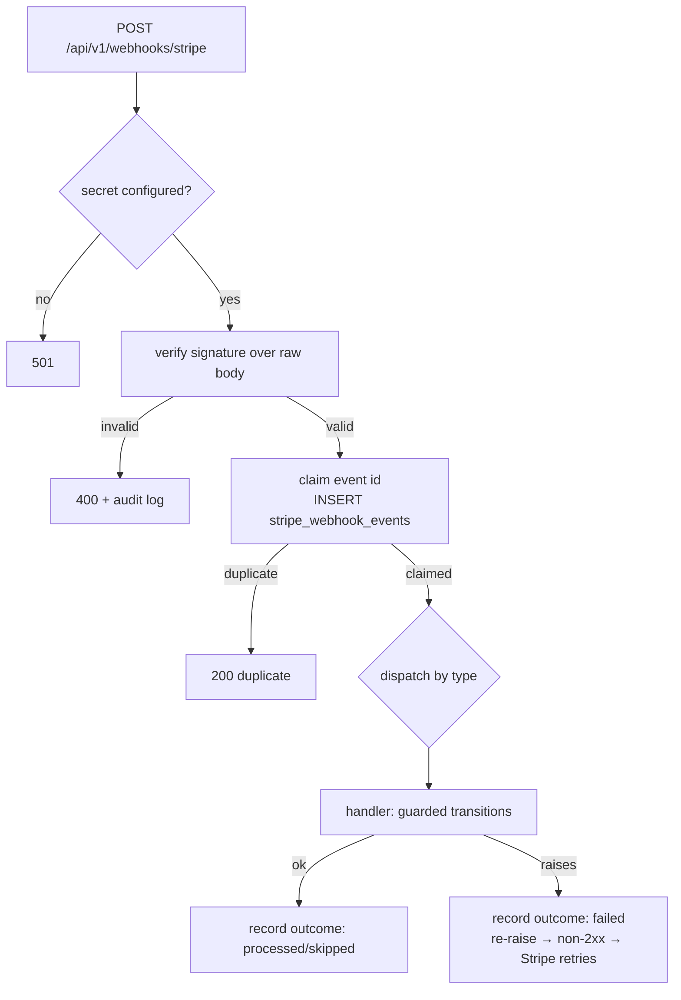

# Payment System Architecture — Transform-To

**Status:** describes the architecture *after* the payment-remediation work of 2026-11-11. The pre-remediation model is documented in `docs/payment-system-audit.md`.

---

## 1. Design principles

1. **Stripe is the authority for billing events; the application owns entitlement.**
   Stripe tells us what happened to a subscription. The application decides what the customer may use, and it must be able to decide that **without** a Stripe round-trip on every request.
2. **Entitlement is derived, never stored.**
   One pure function turns persisted state into a tier. No caller reads the purchased plan and treats it as an entitlement.
3. **Eventual consistency must not become indefinite access.**
   Caches, webhooks and background jobs may be late. The deadline is enforced on **read**, so lateness can never extend access.
4. **Revocation ≠ cancellation.**
   Removing entitlement is a local, reversible act. The Stripe subscription is left untouched so payment can restore the plan.
5. **Every state transition is one guarded SQL statement.**
   The guard is the idempotency mechanism; duplicate deliveries, replays and concurrent workers cannot move state twice.

---

## 2. The four axes

The pre-fix model collapsed four independent questions into `user_subscriptions.tier`. They are now separate:

| Axis | Storage | Written by | Question answered |
|---|---|---|---|
| **Plan** | `user_subscriptions.tier` (PG enum) | webhooks, `/change-plan` | What did the customer buy? |
| **Stripe mirror** | `stripe_status`, `current_period_end`, `cancel_at_period_end` | webhooks | What did Stripe last report? |
| **Payment recovery** | `payment_state`, `grace_started_at`, `grace_deadline_at`, `grace_source_invoice_id`, `last_payment_failed_at`, `last_payment_event_at`, `previous_paid_tier`, `entitlement_revoked_at` | webhooks + sweeper | Is that plan currently paid for? |
| **Enforced entitlement** | *not stored* — derived | — | What may the customer use right now? |



---

## 3. Subscription lifecycle state machine

### 3.1 States

| `payment_state` | Meaning | Entitlement |
|---|---|---|
| `OK` | Paid and current (or free) | `tier` |
| `GRACE` | A renewal payment failed; inside the recovery window | `tier` until `grace_deadline_at` |
| `REVOKED` | The window closed without payment | `FREE` |

`tier` continues to record the plan the customer bought, even in `REVOKED`, so recovery can restore it. `previous_paid_tier` additionally records the plan removed at revocation, so restoration never has to re-derive it from possibly-stale metadata.

### 3.2 Transitions



### 3.3 Stripe status → action

| Stripe status | Action | Why |
|---|---|---|
| `active`, `trialing` | activate the resolved tier; clear grace | paid (or trial-authorised) access |
| `past_due`, `unpaid`, `paused` | keep the plan, open/continue grace | payment is outstanding; access is time-bounded |
| `canceled`, `incomplete_expired` | `tier := FREE`, clear grace | terminal |
| `incomplete` | `tier := FREE` | checkout never completed |
| absent / unknown | mirror only | never grant, never revoke on unknown input |

`incomplete_expired` and `incomplete` previously fell through to activation, which handed a paid tier to anyone who abandoned checkout.

---

## 4. Grace-period design

### 4.1 The rule

> Paid entitlement survives a failed recurring payment for at most **three business days** (Monday–Friday, excluding configured holidays). After that, entitlement is removed automatically, server-side.

### 4.2 Why the deadline is persisted

- **Not extendable by replay.** The `OK → GRACE` transition is a guarded `UPDATE ... WHERE payment_state = 'OK'`. A duplicate or a later failure matches zero rows, so the deadline is written exactly once per window.
- **Not extendable by dunning retries.** The anchor is the failing **invoice's** creation instant (`invoice.created`), which is stable across retries. Anchoring on `event.created` would move the deadline on every retry.
- **Restart- and outage-safe.** There is no in-memory timer. Downtime spanning the deadline is caught by the next entitlement read.
- **Not extendable by added holidays later.** Existing deadlines are never recomputed.

### 4.3 Day counting

`src/domain/subscriptions/policies/payment_grace.py::grace_deadline`:

- Count from the **next** calendar day; only Mon–Fri (minus configured holidays) increment the counter.
- The deadline is the **end of** the third business day (`23:59:59.999999`) in `PAYMENT_GRACE_TIMEZONE`, converted to UTC. Constructing it through `ZoneInfo` keeps it correct across DST transitions.
- A naive anchor is rejected outright.

| Failure | Business days | Deadline |
|---|---|---|
| Fri 2026-11-06 14:00 | Mon 09, Tue 10, Wed 11 | **Wed 2026-11-11 23:59:59.999999Z** |
| Sat 2026-11-07 02:00 | Mon 09, Tue 10, Wed 11 | **Wed 2026-11-11 23:59:59.999999Z** |
| Wed 2026-11-11 23:30 | Thu 12, Fri 13, Mon 16 | **Mon 2026-11-16 23:59:59.999999Z** |

### 4.3.1 Existing calendar conventions (checked, not assumed)

The repository had no holiday calendar and no business-day arithmetic before this
change. Its only existing time convention is **UTC**:

- `domain/subscriptions/value_object/credit_period.py` buckets credits by **UTC
  calendar month** and normalises any instant to UTC (`ensure_utc`).
- Job and file retention windows are expressed in UTC.
- Stripe reports timestamps in UTC.

The grace policy therefore defaults to `PAYMENT_GRACE_TIMEZONE=UTC`, which is
consistent with the rest of the system rather than a second definition. A
deployment that needs a local business calendar can set the timezone and a
holiday list explicitly; both are validated at boot. Because deadlines are
persisted and never recomputed, enabling a holiday calendar later does **not**
retroactively change existing windows.

### 4.4 Two enforcement layers (both required)

| Layer | Mechanism | Guarantees |
|---|---|---|
| **Read-time** | `SQLSubscriptionRepository.get_tier_for_user` / `get_actor_tier` call `effective_tier(...)` | The maximum is a maximum. A stopped worker, a dead host, or a late queue cannot extend access. Every gate inherits it because they all go through this call. |
| **Sweeper** | `workers/billing_worker` every `PAYMENT_GRACE_SWEEP_INTERVAL_SECONDS` (default 300) | Convergence: `tier` is actually lowered, `entitlement_revoked_at` is recorded, the plan credit bucket is clamped. Also handles users who make no requests. |

Neither alone is sufficient: read-time only leaves the stored row (and therefore `/status`, the billing UI, and any direct reader) claiming a paid plan; sweep-only makes the maximum unbounded by however long the worker is down.

### 4.5 Sweeper safety

- One transaction per sweep, so the transaction-scoped advisory lock is held for the whole run.
- `pg_try_advisory_xact_lock(<fixed key>)` — a constant, not `hashtext(...)`, because `hashtext` is not stable across PostgreSQL majors.
- `SELECT ... FOR UPDATE SKIP LOCKED` + `payment_state = 'GRACE'` + `grace_deadline_at <= now()` (database clock) makes each update idempotent and prevents duplicate work even if the lock is bypassed.
- Batch capped at 200 rows per tick.
- **No Stripe calls.** Revocation survives a Stripe outage and cannot accidentally cancel a subscription.

### 4.6 Recovery

| Situation | Behaviour |
|---|---|
| Payment succeeds **during** grace | `subscription.updated(active)` or `invoice.payment_succeeded` with status `active` → `clear_grace`, plan already intact |
| Payment succeeds **after** revocation | Same triggers; the plan is restored from the price/metadata, and `previous_paid_tier` records what was removed |
| Payment succeeds on a **cancelled** subscription | Refused: `is_terminal(status)` → downgrade, never restore |
| Duplicate success | Order-guarded zero-row no-op |
| Stale success after a newer failure | Rejected by `last_payment_event_at <= event.created` |

---

## 5. Webhook processing design



Properties:

- **Idempotency** is a primary key on `stripe_webhook_events.event_id`, not a read-then-write race.
- **Retryable failures.** A row left `received`/`failed` may be reprocessed by a retry; `processed`/`skipped` rows are refused.
- **Ordering** uses `last_payment_event_at`, compared against the Stripe `event.created`.
- **Ownership resolution** prefers `stripe_subscription_id`, then `stripe_customer_id`, then a single Stripe retrieve for metadata. A failure to resolve returns without writing and logs at WARNING.
- **No silent swallowing.** Handlers that cannot act log and return; handlers that error propagate so Stripe retries.

---

## 6. Entitlement enforcement design

One derivation, one choke point:

```python
# src/infrastructure/adapters/repository/sql_subscription_repo.py
get_tier_for_user(user_id) -> SubscriptionTier:
    row = <select user_subscriptions where user_id = ? />
    return effective_tier(
        tier=row.tier,
        payment_state=row.payment_state,
        grace_deadline_at=ensure_utc(row.grace_deadline_at),
        stripe_status=row.stripe_status,
        now=datetime.now(UTC),
    )
```

Rules inside `effective_tier`:

1. `tier ∈ {FREE, GUEST}` → unchanged.
2. `stripe_status ∈ {canceled, incomplete, incomplete_expired}` → `FREE`.
3. `payment_state == REVOKED` → `FREE`.
4. `payment_state == GRACE` and `now >= grace_deadline_at` → `FREE`.
5. `payment_state == GRACE` and no deadline → `FREE` (a defect must never read as unlimited access).
6. Unknown state → `FREE`.
7. Otherwise → `tier`.

Consumers that inherit this automatically:

| Subsystem | Call site |
|---|---|
| Storage quota + per-file cap | `application/services/files/service.py` |
| Plan credit allowance | `application/services/billing/credit_service.py` |
| AI assistant model / hourly quota / attachments / actions | `api/routers/v1/assistant.py`, `infrastructure/adapters/repository/sql_assistant_account_adapter.py` |
| Queue priority | `api/routers/v1/conversions.py`, `workflows.py` |
| Credits & dashboard | `api/routers/v1/credits.py`, `dashboard.py` |
| MCP scope | `presentation/mcp/dependencies.py` |
| Worker-side credit gate | `workers/converter_workers/dependencies.py` |

**No frontend gating is load-bearing.** Hiding a button is presentation; enforcement is the derived tier at the repository.

---

## 7. Revocation semantics

What revocation does, in one transaction:

```
tier                  := FREE
previous_paid_tier    := <the plan removed>
payment_state         := REVOKED
entitlement_revoked_at:= now()
monthly_credits (current period): allowance, remaining := min(current, FREE grant)
```

What it deliberately does **not** do:

| Not done | Reason |
|---|---|
| Cancel the Stripe subscription | Revocation and cancellation are different operations; the subscription is left as Stripe reports it so payment can restore the plan |
| Delete files or customer data | Entitlement is not data ownership |
| Zero `purchased_credits` | Those were bought outright and never expire |
| Zero `carryover_credits` | It has its own expiry date; destroying it on a recoverable failure is worse than letting it lapse |
| Clear `stripe_subscription_id` | Recovery and reconciliation need it |

---

## 8. Configuration

| Setting | Default | Effect |
|---|---|---|
| `PAYMENT_GRACE_BUSINESS_DAYS` | `3` | Window length. Rejected at boot if negative. |
| `PAYMENT_GRACE_TIMEZONE` | `UTC` | Zone that defines a business day. Validated at boot. |
| `PAYMENT_GRACE_HOLIDAYS` | `""` | Comma-separated ISO dates; validated at boot. |
| `PAYMENT_GRACE_SWEEP_INTERVAL_SECONDS` | `300` | Sweeper cadence. A ceiling on convergence, not on access. |

Boot validation also rejects `STRIPE_SECRET_KEY` set without `STRIPE_WEBHOOK_SECRET`: that configuration charges customers while rejecting every event.

---

## 9. Deployment topology

| Process | Image | Database | Role |
|---|---|---|---|
| `transform-api` | `worker.Dockerfile` | production | serves `/api/*`; webhooks; read-time enforcement |
| `worker` (×N) | same | production | conversions; spends credits |
| `worker-cleanup` | same | **dev `.env` only** | guest data retention (unchanged) |
| **`worker-billing`** | same | production override | grace sweep; no Stripe calls |
| `worker-workspace` | same | production | cloud workspaces |

`worker-billing` takes the production env override precisely because it changes entitlement — the cleanup worker's dev-database default would have revoked subscriptions in the wrong database.

---

## 10. Known architectural gaps

1. **No Stripe reconciliation loop.** A missed event still needs a human. The status mapping is centralised precisely so a daily reconciliation pass can reuse it.
2. **Credits are not reserved at job creation.** The gate is a read, the charge is a post-completion write clamped at zero.
3. **One subscription per user** is a schema assumption (`user_id UNIQUE`).
4. **Invoices are not persisted**, so billing history depends on a live Stripe call.
5. **Per-key and per-tier rate limits are declared but unread.**
